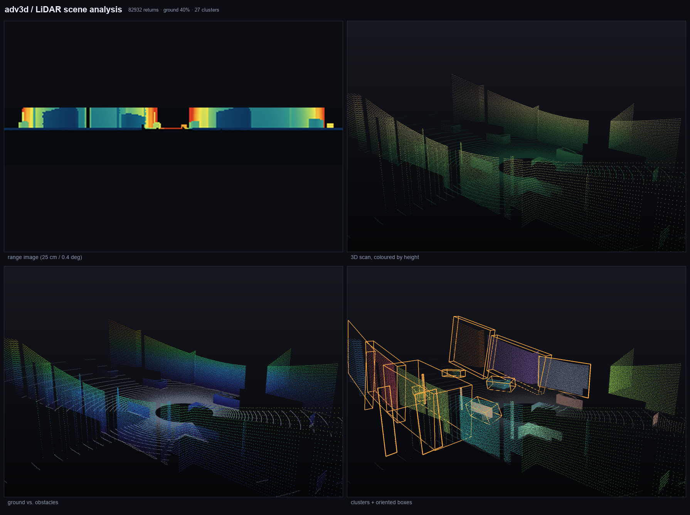
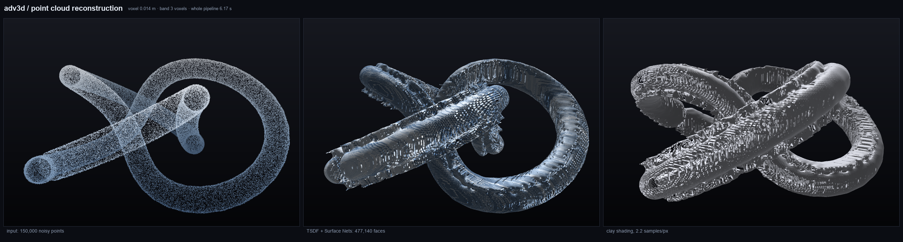
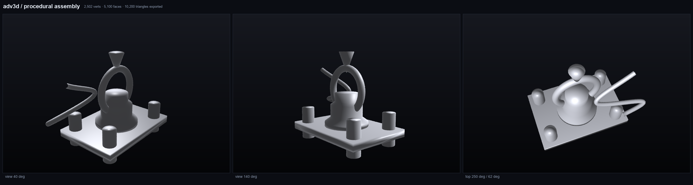
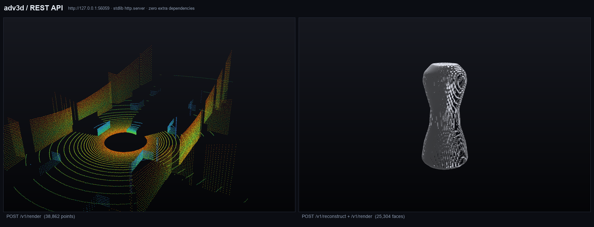

# adv3d — 面向工程的高性能 3D 点云 / 建模 / 可视化库

**一个硬依赖（numpy），一个可选依赖（Pillow）。没有 OpenGL、没有 Qt、没有 scipy、没有 GPU。**
点云重建、激光雷达可视化与解析、程序化建模、无头软件渲染、REST 服务，全部用 numpy
向量化 + 显式分块实现，峰值内存由代码里的预算约束决定，而不是靠运气。

```
C:\Users\sg\Desktop\ws\3D-ADVANCE-API
├── adv3d/           库本体（core / io / recon / lidar / modeling / render / datasets / api）
├── examples/        4 个可直接运行的示例，各自产出图片与数据文件
├── benchmarks/      吞吐与内存基准（README 里的数字全部来自它）
├── tests/           4 个冒烟测试（索引/IO/渲染/流水线，含数值断言）
├── docs/            API.md、performance.md
└── outputs/         示例产出的图与数据（重建、LiDAR、建模、API）
```

---

## 1. 快速开始

```powershell
cd C:\Users\sg\Desktop\ws\3D-ADVANCE-API
python -m pip install numpy                # 唯一必需依赖
python -m pip install pillow               # 只有导出 PNG 时才需要
```

```python
import adv3d

pc = adv3d.load("scan.ply")                                   # PLY/PCD/OBJ/STL/LAS/XYZ
clean, _ = adv3d.remove_statistical_outliers(pc, k=16, std_ratio=1.5)
down = adv3d.voxel_downsample(clean, 0.01)
adv3d.estimate_normals(down, radius=0.03)

mesh, stats = adv3d.recon.reconstruct(down, voxel=0.01)        # TSDF + Surface Nets
adv3d.save(mesh, "mesh.ply")

cam = adv3d.render.Camera.orbit((0, 0, 0), 4.0, 35, 18, fov=40, width=960, height=640)
canvas = adv3d.render.Canvas(cam, supersample=2)
canvas.paint_mesh(mesh, colormap="steel")
canvas.save("preview.png")
```

安装为包（可选出 `adv3d-serve` 命令）：

```powershell
python -m pip install -e .
```

---

## 2. 示例与示例效果

四个脚本都是可独立运行的完整流程，最后把结果写到 `outputs/`。

### 示例 1 — 激光雷达场景：模拟扫描 → range image → 地面分割 → 聚类 → 有向包围盒

```powershell
python examples\01_lidar_scene.py
```

解析式 ray/box 求交模拟 64 线旋转雷达（seed 固定，零下载），10 万级回波在 **0.3 s** 内产生；
随后一次 `analyze_scan` 同时给出地面占比、聚类数量、目标高度、OBB 与 range image 覆盖率。



实测：64 线、0.2° 方位分辨率 → 103,509 回波 / 0.28 s；range image `(101, 1800)` 覆盖率 17.9%；
地面占比 39.8%，27 个簇，最高目标 12.4 m。

### 示例 2 — 点云重建：噪声点云 → TSDF 融合 → Surface Nets 水密网格

```powershell
python examples\02_pointcloud_recon.py
```

15 万带噪声点 → SOR 去噪 → 1.4 cm 体素降采样 → PCA 法线 → 24.7 MB 体素场 → 三角网格（47.7 万面）。



实测：整条流水线 **6.1 s**（SOR 2.2 s、法线 0.55 s、融合+提面+平滑 3.3 s），
网格体积 0.51 m³、表面积 29.8 m²，采样点到原始点云的中位偏差 10.7 mm（≈1 个体素）。
未观测空间用「粗网格外部洪泛填充」定符号——跳过这步就会得到经典的内外双层壳。

### 示例 3 — 程序化建模：原语 → 装配 → 导出 OBJ/PLY

```powershell
python examples\03_modeling.py
```

底板 + 四立柱 + 回转体轮毂 + 圆环 + 喷口 + 扫掠管，全部由 `box/sphere/cylinder/cone/torus/revolve/tube` 生成。



实测：2,502 顶点 / 5,100 面，构建 11 ms；原语的网格体积与解析值误差
**球 0.60%、圆柱 0.29%、圆锥 0.29%、立方体 0.00%**（符号体积同时校验绕序）。

### 示例 4 — 通过 REST API 调用（不是 `import`）

```powershell
python examples\04_api_demo.py
# 对外提供服务：
python -m adv3d.api.server --host 0.0.0.0 --port 8000
```

标准库 `ThreadingHTTPServer`，上传/下载走二进制流，不需要 FastAPI/uvicorn。



```text
GET  /health                     -> {status, version}
GET  /v1/info                    -> 能力探测
POST /v1/pointcloud/summary      -> JSON 统计
POST /v1/pointcloud/downsample   -> PLY
POST /v1/pointcloud/outliers     -> PLY
POST /v1/lidar/analyze           -> JSON 报告
POST /v1/reconstruct             -> PLY 网格
POST /v1/render                  -> PNG 渲染
```

```python
from adv3d.api import Client
c = Client("http://127.0.0.1:8000")
mesh, meta = c.reconstruct(pc, voxel=0.02)        # 结果直接是 Mesh 对象
png = c.render(mesh, width=960, height=640, colormap="clay", out_path="a.png")
```

---

## 3. 性能（本机实测，详见 [docs/performance.md](docs/performance.md)）

| 操作 | 实测 |
|---|---|
| 体素降采样 | **5 884 k pts/s**（1,000,000 点） |
| PCA 法线 | **135.0 k pts/s** |
| 统计离群点去除（SOR） | **311.0 k pts/s** |
| PLY 二进制写 / 读 | **50.4 M pts/s** / **36.9 M pts/s** |
| 点云渲染（960×640，2×SSAA） | **458 k pts/s** |
| 网格渲染（960×640，2×SSAA） | **38.9 k faces/s** |
| TSDF 融合 | **13.9 M voxels/s** |
| 重建端到端 | 47.6 万面 / **3.23 s** |
| 模拟 64 线 LiDAR | **390.3 k rays/s** |
| `analyze_scan`（地面+聚类+OBB） | **1 007 k pts/s** |

内存：体素场上限 **24 M（≈96 MB）**；1M 点法线邻域缓存 4M 对上限；渲染按
8 192 面 / 25 万喷溅分块。基准全流程进程峰值 **618 MB**（1M 点 + 重建 + 渲染一气跑完），单步探针峰值 700 MB，重建 6 M 体素的
端到端常驻内存 **160 MB**。

复现：`python benchmarks\run_bench.py`

---

## 4. 能力矩阵

| 模块 | 能力 |
|---|---|
| `adv3d.core` | `PointCloud` / `Mesh` / `GridIndex`（哈希网格替代 KD-tree）/ 体素降采样 / SOR / 半径滤波 / PCA 法线与曲率 / FPS 采样 / ICP / PCA 粗配准 / Laplacian 平滑 / Loop 细分 / 顶点聚类简化 / 网格采样成点云 |
| `adv3d.io` | PLY（ascii+binary，点/网格）、PCD、OBJ、STL、LAS 0–5 读 / 1.2 写、XYZ/CSV |
| `adv3d.recon` | TSDF 融合（最近点喷溅 + 粗网格洪泛定符号）、Surface Nets 提面、组织化网格（深度图/range image）三角化 |
| `adv3d.lidar` | range image 投影/反投影/可视化、深度不连续检测、行统计、网格与 RANSAC 地面分割、离地高度、欧氏聚类、range-image 聚类、OBB/AABB、一次调用出完整报告 |
| `adv3d.modeling` | box/sphere/cylinder/cone/torus/plane/disc/extrude/revolve/tube + merge/duplicate/mirror/translate/rotate/scale/fit/smooth/simplify/subdivide/weld/orient_outward/frame |
| `adv3d.render` | 无头软件光栅：SSAA、自适应三角形喷溅、Phong 着色、深度淡出、13 种色图、线/包围盒/地面网格、图集排版 |
| `adv3d.datasets` | 程序化城市街景、解析式 LiDAR 模拟器、环面结点/花瓶/带障碍地面点云 |
| `adv3d.api` | 标准库 REST 服务 + urllib 客户端（8 个端点） |

---

## 5. 关键设计决定

1. **哈希网格替代 KD-tree**：key = `(cx<<42)|(cy<<21)|cz`（21 bit/轴，零碰撞），
   一次 `searchsorted` 批量算 27 邻域；索引 8 B/点，零依赖。
2. **TSDF + Surface Nets 替代 Marching Cubes**：不需要 256 张查找表，天然水密，
   对偶面片更平滑；每个符号变化格一个顶点，每条符号变化格边发一个四边形。
3. **最近点喷溅 + 粗网格洪泛定符号**：保留单个体素上 `|d|` 最小的观测（而非平均），
   避免曲面法线微倾时远处点投出错误符号；未观测区用 4 体素块的外部洪泛填充定内外，
   避免内层幽灵曲面。
4. **屏幕空间自适应喷溅**：按三角形投影面积分配采样数，样本与点共用一个 z-buffer，
   分块后每块内部按像素归并出最近样本再与已有深度比较，保证跨块遮挡正确；
   超预算的大三角先四分裂，避免“点阵”退化。
5. **一切分块**：`PAIR_BUDGET`、体素总量上限、渲染块大小都是代码里的常量，
   峰值内存因此可预测。

---

## 6. 已知限制（不打算隐藏）

* **没有布尔 CSG**：装配用 `merge` 并集，零件穿插处不做消隐。
* **ICP 每次迭代重建邻域查询**：8k×8k、30 次迭代约 6 s；建议先降采样或减少迭代。
* **1.4 cm 体素重建有体素级“肋纹”**：受 24 M 体素上限约束，想更细腻需要更细体素或更强平滑。
  `decimate_voxel` 会把顶点吸附到粗网格，在细管件上产生台阶，重建示例里因此没有使用它。
* **LAS 写入仅 1.2（格式 0/2）**，没有 LASzip。
* **渲染是 CPU 单线程**：52 k faces/s 量级，适合出图与预览，不适合实时视口；
  实时交互请把 `Canvas.array()` 的结果交给你的 GUI/WebGL。
* 所有绝对耗时都是“本机实测”，换机器会变；跨机器比较请看 pts/s 而不是 ms。

---

## 7. 测试

```powershell
python tests\smoke_core.py       # 哈希网格 / 体素 / 法线 / ICP / 网格算子
python tests\smoke_io.py         # 六种格式往返 + 500k PLY 计时
python tests\smoke_render.py     # 原语符号体积断言 + 四联渲染
python tests\smoke_pipeline.py   # 重建偏差断言 + LiDAR 报告断言
```

四个脚本都以 `OK` 结尾并各自产出图片；断言失败会直接抛异常（不吞异常）。

---

## 8. 许可

仓库中的 `LICENSE` 文件为原始授权文本，未做改动；使用前请按其条款执行。
