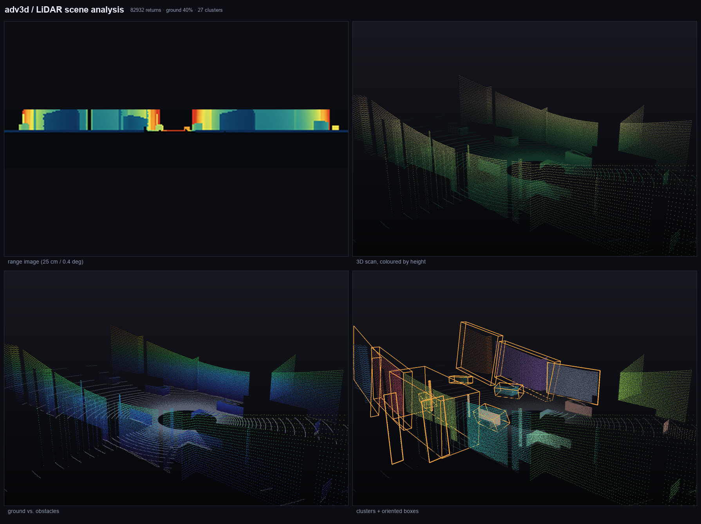
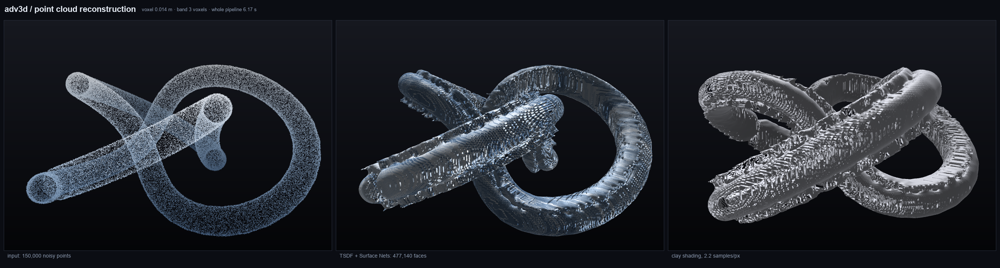
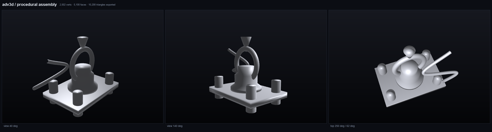
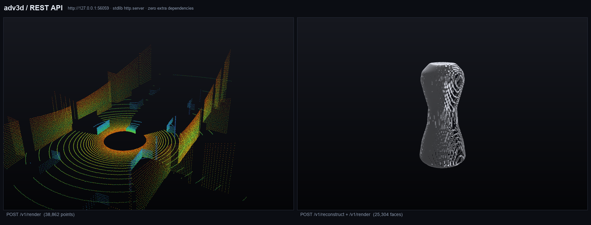

# adv3d — a high-performance 3D point-cloud / modelling / visualisation library for engineering

**One hard dependency (numpy), one optional one (Pillow). No OpenGL, no Qt, no scipy, no GPU.**
Point-cloud reconstruction, LiDAR analytics and visualisation, procedural modelling, a
headless software rasteriser and a REST service — all numpy-vectorised with explicit
chunking, so peak memory is decided by constants in the code, not by luck.

```
C:\Users\sg\Desktop\ws\3D-ADVANCE-API
├── adv3d/           the library (core / io / recon / lidar / modeling / render / datasets / api)
├── examples/        4 runnable end-to-end examples, each writing images + data
├── benchmarks/      throughput and memory benchmarks (every number in this README comes from it)
├── tests/           4 smoke tests with numeric assertions
├── docs/            API.md, performance.md
└── outputs/         produced images and data (reconstruction, LiDAR, modelling, API)
```

---

## 1. Quick start

```powershell
cd C:\Users\sg\Desktop\ws\3D-ADVANCE-API
python -m pip install numpy                # the only required dependency
python -m pip install pillow               # only needed to export PNG
```

```python
import adv3d

pc = adv3d.load("scan.ply")                                   # PLY/PCD/OBJ/STL/LAS/XYZ
clean, _ = adv3d.remove_statistical_outliers(pc, k=16, std_ratio=1.5)
down = adv3d.voxel_downsample(clean, 0.01)
adv3d.estimate_normals(down, radius=0.03)

mesh, stats = adv3d.recon.reconstruct(down, voxel=0.01)        # TSDF + Surface Nets
adv3d.save(mesh, "mesh.ply")

cam = adv3d.render.Camera.orbit((0, 0, 0), 4.0, 35, 18, fov=40, width=960, height=640)
canvas = adv3d.render.Canvas(cam, supersample=2)
canvas.paint_mesh(mesh, colormap="steel")
canvas.save("preview.png")
```

Install as a package (also provides the `adv3d-serve` entry point):

```powershell
python -m pip install -e .
```

---

## 2. Examples and their results

Each script is a complete, independently runnable pipeline; results land in `outputs/`.

### Example 1 — LiDAR scene: simulated scan → range image → ground split → clustering → oriented boxes

```powershell
python examples\01_lidar_scene.py
```

An analytic ray/box sensor model produces a 64-beam spinning scan (~100 k returns)
in **0.3 s**, then a single `analyze_scan` call reports ground ratio, cluster count,
object heights, oriented boxes and range-image coverage.



Measured: 103,509 returns in 0.28 s; range image `(101, 1800)` at 17.9 % coverage;
ground 39.8 %, 27 clusters, tallest object 12.4 m.

### Example 2 — Point-cloud reconstruction: noisy cloud → TSDF → watertight mesh

```powershell
python examples\02_pointcloud_recon.py
```

150 k noisy points → SOR → 1.4 cm voxel grid → PCA normals → 24.7 MB signed-distance
volume → 477 k-face triangle mesh.



Measured: whole pipeline **6.1 s** (SOR 2.2 s, normals 0.55 s, fusion + extraction +
smoothing 3.3 s); mesh volume 0.51 m³, area 29.8 m², median deviation from the input
cloud 10.7 mm (≈ one voxel). Unobserved space is signed by a coarse outside flood fill —
skipping that step is exactly what produces the classic inner/outer double shell.

### Example 3 — Procedural modelling: primitives → assembly → OBJ/PLY

```powershell
python examples\03_modeling.py
```

Base plate + four posts + revolved hub + ring + nozzle + swept tube, built from
`box/sphere/cylinder/cone/torus/revolve/tube`.



Measured: 2,502 vertices / 5,100 faces built in 11 ms; primitive volumes match the
analytic values to **sphere 0.60 %, cylinder 0.29 %, cone 0.29 %, box 0.00 %**
(signed volume doubles as a winding-order check).

### Example 4 — Calling it over REST (not `import`)

```powershell
python examples\04_api_demo.py
# expose it for a real client:
python -m adv3d.api.server --host 0.0.0.0 --port 8000
```

Standard-library `ThreadingHTTPServer`; uploads and downloads are binary streams.
No FastAPI, no uvicorn.



```text
GET  /health                     -> {status, version}
GET  /v1/info                    -> capabilities
POST /v1/pointcloud/summary      -> JSON statistics
POST /v1/pointcloud/downsample   -> PLY
POST /v1/pointcloud/outliers     -> PLY
POST /v1/lidar/analyze           -> JSON report
POST /v1/reconstruct             -> PLY mesh
POST /v1/render                  -> PNG
```

```python
from adv3d.api import Client
c = Client("http://127.0.0.1:8000")
mesh, meta = c.reconstruct(pc, voxel=0.02)        # comes back as a Mesh object
png = c.render(mesh, width=960, height=640, colormap="clay", out_path="a.png")
```

---

## 3. Performance (measured on this machine, see [docs/performance.md](docs/performance.md))

| operation | measured |
|---|---|
| voxel downsample | **5,884 k pts/s** (1,000,000 pts) |
| PCA normals | **135.0 k pts/s** |
| statistical outlier removal | **311.0 k pts/s** |
| PLY binary write / read | **50.4 M pts/s** / **36.9 M pts/s** |
| point render (960×640, 2×SSAA) | **458 k pts/s** |
| mesh render (960×640, 2×SSAA) | **38.9 k faces/s** |
| TSDF fusion | **13.9 M voxels/s** |
| reconstruction end-to-end | 476 k faces / **3.23 s** |
| simulated 64-beam LiDAR | **390.3 k rays/s** |
| `analyze_scan` (ground + clusters + boxes) | **1,007 k pts/s** |

Memory: the voxel volume is hard-capped at **24 M voxels (≈96 MB)**; neighbourhood
pairs at 4 M per batch; rendering blocks at 8,192 triangles and 250 k splats.
Whole benchmark run peak **618 MB** (1 M points + reconstruction + render in one process); single probe sequence 700 MB; end-to-end reconstruction of
a 6 M-voxel volume stays at **160 MB** resident.

Reproduce: `python benchmarks\run_bench.py`

---

## 4. Capability matrix

| module | capabilities |
|---|---|
| `adv3d.core` | `PointCloud` / `Mesh` / `GridIndex` (hash grid instead of a KD-tree) / voxel downsample / SOR / radius filter / PCA normals + curvature / FPS / ICP / PCA alignment / Laplacian smoothing / Loop subdivision / vertex-cluster decimation / mesh → point sampling |
| `adv3d.io` | PLY (ascii + binary, cloud + mesh), PCD, OBJ, STL, LAS formats 0–5 read / 1.2 write, XYZ/CSV |
| `adv3d.recon` | TSDF fusion (nearest-point splatting + coarse flood-fill sign), Surface Nets extraction, organised-grid (depth/range image) triangulation |
| `adv3d.lidar` | range-image projection / unprojection / view, depth discontinuities, per-ring stats, grid and RANSAC ground segmentation, height above ground, Euclidean clustering, range-image clustering, OBB/AABB, one-call scan report |
| `adv3d.modeling` | box/sphere/cylinder/cone/torus/plane/disc/extrude/revolve/tube + merge/duplicate/mirror/translate/rotate/scale/fit/smooth/simplify/subdivide/weld/orient_outward/frame |
| `adv3d.render` | headless rasteriser: SSAA, adaptive triangle splatting, Phong shading, depth fade, 13 colormaps, lines / boxes / ground grid, contact sheets |
| `adv3d.datasets` | procedural city scene, analytic LiDAR simulator, torus-knot / vase / plane-with-obstacles clouds |
| `adv3d.api` | stdlib REST service + urllib client (8 endpoints) |

---

## 5. Design decisions that explain the numbers

1. **Hash grid instead of a KD-tree**: key = `(cx<<42)|(cy<<21)|cz` (21 bits per axis,
   collision-free), 27-neighbourhoods resolved with one batched `searchsorted`;
   8 B/point and zero dependencies.
2. **TSDF + Surface Nets instead of Marching Cubes**: no 256-entry table, watertight by
   construction, smoother dual surface; one vertex per sign-changing cell, one quad per
   sign-changing grid edge.
3. **Nearest-point splatting + coarse flood-fill signing**: each voxel keeps the
   observation with the smallest `|d|` rather than an average — averaging lets a point
   three voxels away with a slightly tilted normal vote for the wrong side of the surface.
   Unobserved space is signed by a flood fill on a 4-voxel block grid, which is what
   prevents the inner ghost shell.
4. **Screen-space adaptive splatting**: the sample count follows projected triangle
   area, samples share one z-buffer with points, and each block is reduced to one
   nearest sample per pixel before being tested against the buffer — so occlusion stays
   correct across blocks. Over-budget triangles are quadrisected first, so a
   screen-filling plate never degenerates into a dotted surface.
5. **Everything is chunked**: `PAIR_BUDGET`, the voxel cap and the render block sizes are
   constants in the code, which makes peak memory predictable.

---

## 6. Known limitations (not hidden)

* **No boolean CSG**: assemblies are unions (`merge`); intersecting parts are not trimmed.
* **ICP rebuilds its neighbourhood search every iteration**: 8 k×8 k, 30 iterations ≈ 6 s.
  Downsample first, or cut the iteration count.
* **1.4 cm-voxel reconstructions show voxel-scale ribbing**: the 24 M-voxel cap bounds
  how fine you can go. Use a finer voxel or stronger smoothing. `decimate_voxel` snaps
  vertices to a coarse grid and puts visible stair-steps on thin tubes, which is why the
  reconstruction example does not use it.
* **LAS writing is 1.2 (formats 0/2) only**; no LASzip.
* **Rendering is single-threaded CPU**: ~52 k faces/s, fine for stills and previews,
  not for a real-time viewport — hand `Canvas.array()` to your GUI/WebGL instead.
* Absolute timings are machine-specific; compare pts/s across machines, not ms.

---

## 7. Tests

```powershell
python tests\smoke_core.py       # hash grid / voxels / normals / ICP / mesh ops
python tests\smoke_io.py         # six format round-trips + 500k PLY timing
python tests\smoke_render.py     # primitive signed-volume assertions + 4-panel render
python tests\smoke_pipeline.py   # reconstruction deviation + LiDAR report assertions
```

Each script ends with `OK` and writes its own image; assertion failures raise — nothing
is swallowed.

---

## 8. License

The `LICENSE` file in the repository is the original text and has not been modified;
follow its terms.
